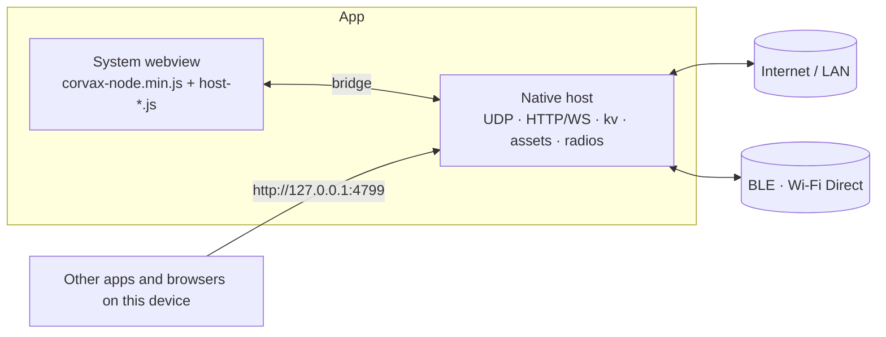

# corvax-native

Small native apps that run a [CORVAX](https://github.com/sloev/CORVAX) node on your computer or phone, in the background.

> **Status:**
> - **Desktop:** built and run on Linux. A **4.6 MB** release binary; the node runs inside it, and other CORVAX apps on the machine found it and messaged through it.
> - **Android:** a sketch, not yet built.
>
> See [Build and test](#build-and-test).

## One codebase

The apps contain **no protocol code**. They run CORVAX's own node bundle, `corvax-node.min.js` (70 KB, from each CORVAX release), inside the platform's built-in webview. They add only a thin **host**: the five I/O operations of [SPEC §11](https://github.com/sloev/CORVAX/blob/main/SPEC.md#11-host-interface).



- **WebRTC and crypto** come from the webview (Chromium on Android and Windows, WebKit on macOS and Linux), so nothing heavy is bundled.
- **Other apps on the device** find the node at `http://127.0.0.1:4799` by themselves (CORVAX's local-node discovery), and use it as their inbox, storage and relay.
- **The UI** is the node's own homepage (DOX / APP / STATS), shown in a window.

| App | Shell | Background | Target size |
|---|---|---|---|
| `desktop/` | Tauri v2 (Rust), system webview | Tray icon, start at login, App Nap off on macOS | ≤ 8 MB (measured: 4.6 MB, Linux x64) |
| `android/` | Kotlin, `android.webkit` + `androidx.webkit` | Foreground service of type `connectedDevice`, headless WebView with renderer priority `IMPORTANT` | ≤ 6 MB APK |

## Mesh over local radios (Android)

Per [SPEC §12](https://github.com/sloev/CORVAX/blob/main/SPEC.md#12-local-radio-links-apps):

- **BLE:**
  - Advertises the CORVAX service with the first 8 bytes of the node's key, and scans for others.
  - A GATT characteristic pair carries KRPC in chunks.
  - The host shows BLE peers to the core as UDP addresses `ble:<id>`, so the existing DHT and KRPC code works over Bluetooth unchanged.
- **Wi-Fi Direct:**
  - Advertises `_corvax._udp` over DNS-SD with the node's anchor line, and discovers others.
  - Once in a group, nodes speak normal UDP, HTTP and WebRTC over the group network.
- **LAN:** mDNS and broadcast discovery run in the shared core; the host holds a `MulticastLock`.

**Policy:**
- Relaying and storing for others only on Wi-Fi while charging.
- On battery: presence, messages and local discovery only.
- A pause switch in the notification.

## Layout

```
shared/host-bridge.js   the JS half of every host: turns bridge events into the SPEC §11 host interface
desktop/                Tauri v2: src-tauri/ (Rust host, tray), web/ (node.html: starts the node)
android/                Gradle project: NodeService (foreground), HostBridge (UDP/HTTP/WS/kv), Radios (BLE, Wi-Fi Direct)
```

## Build and test

`./fetch-corvax.sh` copies the CORVAX node bundle, library and logo from npm into `shared/corvax/`, and `shared/` into both apps.

- **Shared JS host (tested):** `node --test shared/test/bridge.test.mjs` runs the whole node through `host-bridge.js` against a simulated native side, and a normal CORVAX app uses it as its local node.

- **Desktop:** `cd desktop && npm i -g @tauri-apps/cli@2 && tauri build` (Linux needs `libwebkit2gtk-4.1-dev libgtk-3-dev libayatana-appindicator3-dev librsvg2-dev`).
  - **Checked on Linux:** `cargo build --release` gives 4.6 MB.
  - **Run headless:** `xvfb-run` serves `http://127.0.0.1:4799/`, and two CORVAX peers with no anchor list find it as their local node and exchange a message (about 1 s).
- **Android:** `cd android && ./gradlew assembleRelease` (SDK 35). Install the APK, grant the nearby-devices and notification permissions.

**Acceptance tests (todo):**
1. **Size:** within the targets above.
2. **Phone, 24 h, screen off:** stays reachable through Doze on Pixel, Samsung and Xiaomi.
3. **Two phones, no internet:** find each other over BLE and Wi-Fi Direct and exchange CORVAX messages.
4. **Local node:** a browser on the same device with `Peer.create({ local: true })` uses the app's node.
5. **Desktop:** the hidden window keeps the node running for 24 h with the lid closed and on battery.

Distribution: APKs on GitHub releases, then F-Droid (no Google Play Services used). Desktop: unsigned builds first.
